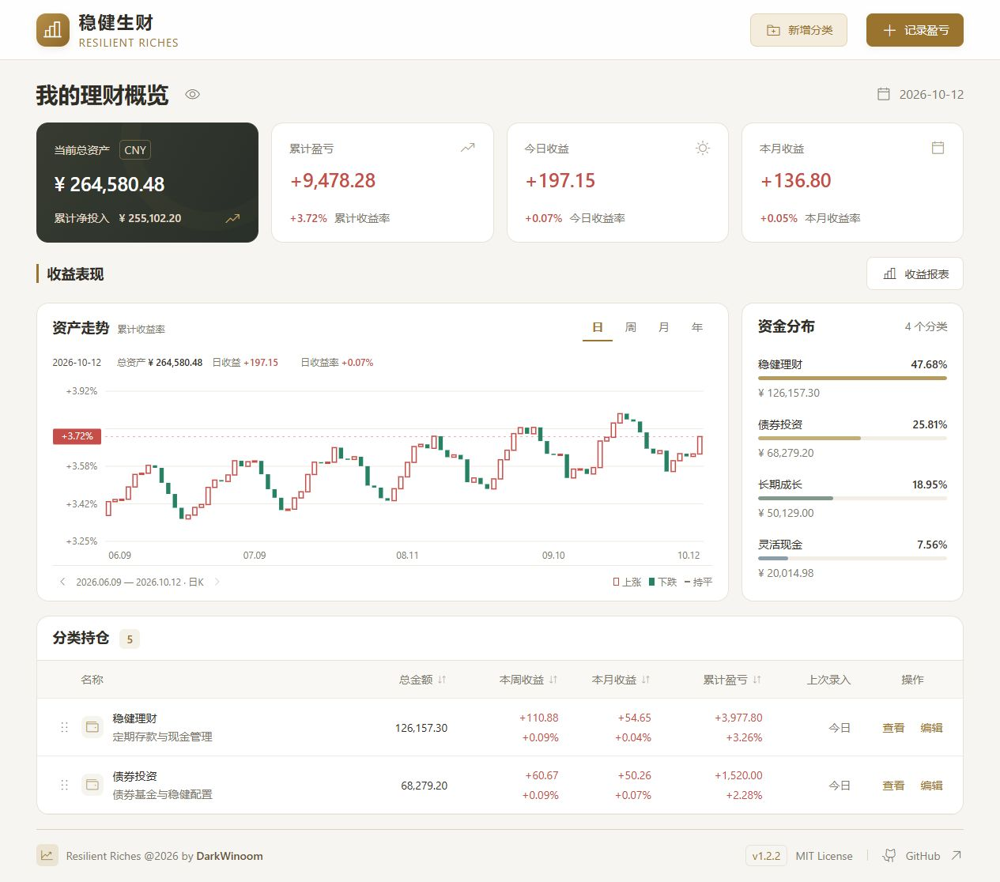

<div align="center">

# 稳健生财

**Resilient Riches**

轻量的个人理财记账应用，清晰掌握资产与收益。

[快速开始](#快速开始) · [版本发布](https://github.com/DarkWinoom/resilient-riches/releases) · [问题反馈](https://github.com/DarkWinoom/resilient-riches/issues)

</div>



## 功能

- 自定义理财分类，按日记录余额与资金进出。
- 日、周、月、年收益率 K 线，查看资产走势与资金分布。
- 分类持仓、收益报表和图片导出，支持隐藏金额。
- 数据保存在本地，支持 Docker 部署。

## 快速开始

安装 Docker Desktop 或 Docker Engine + Compose 后运行：

```sh
git clone https://github.com/DarkWinoom/resilient-riches.git
cd resilient-riches
docker compose up -d --build
```

打开 [http://127.0.0.1:8888](http://127.0.0.1:8888) 即可使用。端口等配置见 [.env.example](.env.example)。应用不设登录，远程访问请限制入口权限。

## 更新

更新前请备份数据，并在原目录运行：

```sh
git pull --ff-only
docker compose up -d --build
```

保留原 Compose 项目名与 `ledger-data` 数据卷，请勿执行 `docker compose down -v`。

## 开源许可

[MIT License](LICENSE) · Made by [DarkWinoom](https://github.com/DarkWinoom)
